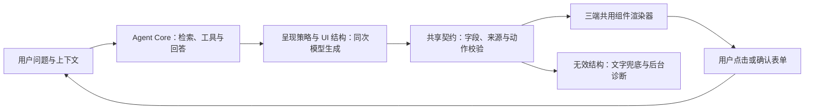

# Agent UI v0.1

回答不再依赖「生成文字后按标题拆卡片」。Agent 在同一轮回答中理解任务、读取证据并选择呈现方式；Presentation Engine 校验结构，前端从固定组件渲染。简单问答保持文字，比较同一维度的对象用表格，完整数值用图表，独立业务事项用信息卡，缺少必要条件时用表单。`presentationPlan` 明确本轮的意图、候选组件和输出模式；办事、比较、条件收集默认采用页面，简单事实与纯文字要求保留文字。最后的字段、布局和数据由模型结合真实上下文选择，证据不足不能凑卡片。



## 结构与组件

权威源码 `presentation/agent-ui.ts`，通过 `node presentation/sync.mjs` 同步到 API 和 web；`--check` 检查是否漂移。这里提供 TypeScript 类型和无依赖运行时校验器，并不声称是第三方生成式 UI 标准。组件注册表同时提供字段约束、模型协议描述和实验室说明。

```card
{"type":"page","version":"0.1","id":"answer","layout":"stack","fallback":"A每天1小时，适合分散时间；B每天2小时，适合整块时间。","children":[{"type":"text","id":"title","role":"heading","content":"学习方案对比"},{"type":"table","id":"comparison","title":"两种安排","columns":["方案","每天投入","适合情况"],"rows":[["A","1小时","时间分散"],["B","2小时","整块时间"]]}]}
```

| 类型 | 用途 | 约束 |
| --- | --- | --- |
| text | 标题、解释、备注 | 纯文本，不执行 HTML |
| image | 已有真实图片 | HTTPS、替代文字、延迟加载、失败提示 |
| info_card | 一个事项、实体或方案 | 摘要、标记、指标和子组件 |
| card_group | 组合或并列选择 | stack/grid，手机自动单列 |
| table | 对象与维度比较 | 最多8列40行，横向滚动保留全文 |
| chart | 真实数值趋势、数量比较 | 柱状/折线，最多24标签3系列，完整数值表可展开 |
| button | 追问或真实入口 | ask/link，用户明确点击；链接统计沿用统一捕获器 |
| form | 收集任务所缺的条件 | 最多8字段，text/number/select；只向 Agent 回传确认内容 |
| steps | 按顺序办理 | 最多24步，序号、下一步与用户勾选进度 |
| checklist | 出发前准备 | 最多24项，材料说明、可选项与勾选 |
| timeline | 真实时间与相对阶段 | 最多24项，不生成未知日期 |
| notice | 关键限制与提醒 | 信息/警告/成功色调，安全 Markdown |
| faq | 可展开的问题与解答 | 最多24项，保留完整答案 |
| options | 澄清具体事项 | 2–12个真实候选，单/多选，确认后回传 |

页面必须包含可读的 `fallback`，版本为 `0.1`，节点有唯一 ID。每页最多48组件、嵌套4层、每组16项、正文累计18000字。未知字段、未知组件、重复ID、非法URL、非有限数值、行列不符及未授权来源均拒绝，不能自动修补后执行。

`sourceRefs` 可位于页面或节点，使用本轮知识证据的 `id`/`citationId`；后台与前端都检查引用集合，后台标记所用来源并保存 `attachments.presentation` 诊断。来源仍统一展示在来源区域，不再输出第二份 sources 卡或正文索引号。引用清理跳过代码/卡片围栏，显示字段单独清理来源编号，避免破坏 JSON 数字数组、动作或来源元数据。

Schema 校验保证结构与引用权限，不证明每个数字或句子真实；事实仍依赖 RAG、工具和管理员审核。没有可核实的数值就不画图，没有真实地址就不放链接。当前未新增语义向量库，也没有多一次模型调用、自动修复重试或未经确认的后台操作。

## 交互与兼容

所有 ask 操作沿用现有卡片事件：管理聊天填入草稿供发送，学生端和体验端按用户点击继续对话；表单会先做必填、数值、选择项与长度检查。模型不能注册任意 JS、HTTP 提交接口或后台写入动作。流式生成期间操作禁用，未闭合 JSON 为生成占位，未知有效 JSON 使用文字兜底；语法损坏的 JSON 按代码保留，不悄悄丢掉内容。

原生 care/crisis/map/places/dinner/effect 等组件继续兼容。危机和关怀保持专用流程，今天吃什么继续读现有红榜及独立库开关。普通 Markdown 标题不会自动改成 sections 卡；需要卡片时由模型声明语义结构。新学生会话只保存真实智能体/技能清单，通用协议由服务器统一注入，减少重复提示词；既有会话的自定义提示词不重写。十四类组件协议约1297估算token（按本轮场景变化），已计入检索证据预算。组件与图表按需加载，图表采用原生 SVG，不引入新的大型图表依赖。

## 界面实验室

`/admin/presentation`，权限 `campus:admin`。支持八类组件及业务组合示例、JSON或含 card 围栏的模型回答粘贴、实时错误反馈、授权来源预览、手机宽度、交互禁用、用户事件预览与复制。预览事件只显示内容，不调用模型、不写入知识库、不计入导览点击统计。页面跟随全局主题和夜间模式。菜单「界面实验室」「体验版反馈」有各自的原生 SVG 图标，使用 currentColor。

组件现已增加为十四类。扩展时更新权威类型/注册表、校验分支、渲染分支、示例与测试，再运行同步检查；当前不是允许第三方随意注册执行代码的开放生态。

## 验证

```powershell
node presentation/sync.mjs --check
pnpm --filter @cagent/api exec ts-node --transpile-only scripts/verify-agent-ui.ts
pnpm --filter @cagent/api exec ts-node --transpile-only scripts/verify-agent-runtime.ts
node apps/api/scripts/check-icons.mjs
node apps/api/scripts/verify-presentation-ui.mjs
pnpm typecheck
pnpm --filter @cagent/api build
pnpm --filter @cagent/web build
```

契约/解析/来源/动作边界测试与实际本地 PostgreSQL 的 ChatService 持久化测试无外部模型调用。三端与实验室 UI 测试使用真实构建页面、实际授权/只读 API，隔离 SSE 和会话夹具；不把它们当成模型实际选择组件的证据。记录在 `storage/shots/presentation/`。部署后另做真实模型请求，验证语义选择与历史结构。


## 2026-10-10 生产验证

已上线 API 20261010-195421 / web 20261010-194008。两轮真实 deepseek-chat 对比请求均选择 table、chart、text，周总小时为5、6；两轮简单换算保持文字，各请求均只有一次模型生成。纯问候和明确单位换算跳过无关校园检索，含校园关键词的换算仍查证据。同题单位换算修复前总token4224，后1300且没有知识库来源；这是单个测试题结果，不是所有回答的通用节省比例。生产模型报告 production-live.json 与 production-live-before-routing.json；实际前端的隔离交互报告 production-ui.json。当前源码、构建和回滚位置见 AGENT.md。


## 自然问题下的组件采用

普通问题原先默认建议 text，旧会话/体验版同时携带另一套通用卡片示例，导致模型只输出 Markdown 或旧类型。真实复测中，校园卡挂失/补办未生成卡片，复习计划输出了顶层 form，旧渲染器无法处理。

统一协议在证据预算前预留，在上下文最终组装时移到旧提示和证据之后，并附本轮真实来源 ID。它明确按内容交付 page，提供本轮相关的完整 JSON 示例，不需要用户指定“用卡片”。体验版新会话仅声明服从服务器协议；原会话自定义指令不改写。原生专用卡保持，用相同次模型回答完成结构化输出。

`normalizeUiDocument` 只为已注册的单组件补 page 外壳，不添加业务字段、替换事实或修复非法动作；`validateUiDocument` 仍使用完整相同校验器。三端、实验室和后台诊断同步支持，顶层表单历史也可正确显示。卡片回答保留真实字段与入口，避免整张卡被删除造成追问失去上下文。最新实现保留经校验的紧凑界面 JSON；连续对话实测发现只提取平面文字会让后续回答模仿文字界面而不输出组件。旧来源编号从历史界面中移除，避免当成本轮证据复用；历史仍按完整轮次和上下文预算裁剪。

诊断中分别记录计划、实际呈现和缺失提醒；“没有解析到页面”不等于“页面已采用”。自然问法实测使用 `verify-presentation-adoption.mjs`，不在问题中提示使用卡片；结果见 production-adoption-before/after.json。UI 回归还覆盖顶层单组件的交互、手机与夜间模式，属于隔离响应验证。


本次生产发布为 API/web 20261010-203713。修复后的六题真实 deepseek-chat 验证全部通过：普通校园卡问题选信息卡组/按钮，缺少计划条件选表单，自然比较选表格，带旧体验协议的会话也选新信息卡；纯文字要求和单位换算保持文字。四个结构化题未要求使用卡片，每题均一轮模型生成。卡片的来源引用通过真实证据校验；只软删除自建验证会话。三端与实验室的顶层表单交互、历史和夜间手机回归通过。结果是该测试集的采用情况，不等于每次生成的保证。


## 流程、准备与连续对话

新增 steps / checklist / timeline / notice / faq / options，正式聊天与实验室共享。步骤带序号、下一步提示、可勾选进度；清单带材料说明和可选标记；时间线保留真实日期/相对阶段；长说明可展开；提醒与问答支持原有安全 Markdown 排版。options 提供单/多选候选，确认后按完整问题回传，配合 form 收集条件。材料、流程、字段和入口分别组织，不再把流程塞进 info_card.summary。

每个流程/清单/时间线/问答最多24项，选项2–12个，字段仍严格校验。旧顶层无 id 的同名卡保持原渲染器；page 内新节点或带 id 的顶层节点走统一校验器。模型不能预置 done/checked，也不能创建提交或后台操作。

步骤与清单的勾选仅在浏览器保存，按消息、节点与内容隔离，最多80个节点；正式会话刷新恢复后仍显示标记，清空可重置，存储不可用时继续使用内存。匿名体验对话仍仅本页保留，刷新会清空会话。实验室不提供消息状态键，因此预览不保存个人标记。更改内容或重新生成的新消息不会继承别的流程进度。勾选不调用模型，也不等于申请或审批状态。

Presentation Engine 识别短追问并从最近用户轮次恢复实际事项，保留原始主题以供连续检索；“材料呢”选择清单，“下一步呢”选择步骤，“再详细一点”沿用场景。明确新事项与纯文字要求不强行继承。RAG 的澄清判断与检索使用相同的 resolvedQuery，避免已有主题的短句再次被误判成未知事项。真实澄清候选提供 options，条件缺失时由模型使用 form，用户已选定后直接继续，不重复询问。查看清单不等于完成办理，未知进度用条件步骤或选项处理。

新增真实模型验证脚本 `verify-workflow-live.mjs` 覆盖多轮校园卡流程→材料→下一步→展开、主动澄清→选择后继续，以及用户给定时间安排。组件和交互回归仍使用隔离响应，模型报告与 UI 报告分别记录，不互相代替。

最终生产 API 20261010-213146 / web 20261010-212125。真实 deepseek-chat 七轮全部 SUCCESS，每轮一次模型生成：首问 steps+checklist，材料追问 checklist，下一步与展开追问 steps，校园卡泛问 options，实际选项值回传后 steps，以及三个给定日期的 timeline。连续三次短追问都检索校园卡来源并保留原始事项。报告 production-workflow-live.json；首次文字退化与平面历史模仿失败分别保留 production-workflow-before.json、production-workflow-flattened-history.json。这是该测试集的结果，呈现选择仍受模型影响；失败会保留文字及诊断，不静默编造卡片或增加重试生成。三端与实验室隔离 UI 回归通过，包含正式会话刷新恢复标记、匿名体验页内会话、手机夜间、选项/表单回传、旧关怀选餐与链接统计。
