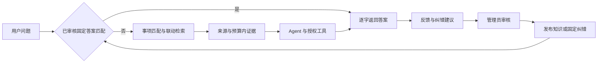

# 知识库、查询、Agent 与反馈优化记录

2026-10-04，本地工作区 `C:\Users\Admin\CAgent`。实现已应用到本地开发库并部署到生产 `https://campus.example.org`；本次包含前端、后端、数据库迁移、知识数据、技能与 Agent 配置。

## 原型的主要问题

原构建入口依赖 `src` 中不存在的主干 JSON，实际事项数据在 Excel 中。门户 full/slim 是重复投影，手册和社区表格也有重复视图。工作簿同时包含真实资料、示例、半真实记录和测试标准答案，旧导入没有保留完整的来源与关联元数据。

查询先取有限数量的候选，再用很粗的关键词打分，正确事项可能在候选上限外。知识同时以数据库记录和整包 PROMPT 技能进入上下文；技能的 ID/key、类型、权限和实际调度路径又不一致。结构化工具返回值与文字答案重复注入，长上下文还可能丢掉当前问题。

反馈支持数量随重复提交增加，撤回后没有可靠扣除；纠错经验通过模型重述，无法保证固定问题得到固定答案。原前端隐藏了学习审核入口。

## 知识源处理

`build-unified.mjs` 是唯一构建实现，旧 `build.mjs` 和 `build-campus-kb.mjs` 保留为兼容入口。所有 14 个源文件计算 SHA-256，并逐条读取 JSON、Markdown 和 Excel 的 12 个工作表。

| 来源 | 进入检索的块数 | 处理方法 |
| --- | ---: | --- |
| 校园门户 full | 4,835 | 保留入口与原记录定位 |
| 校园门户 slim | 0 | 与 full 逐条核对，作为重复投影排除 |
| 一站式平台 | 72 | 服务入口 |
| UCASSbook | 840 | 恢复小节名称、章节路径和子目录概览，标为同学整理资料 |
| 辛瓜生存指北 | 16 | 重新细分长块，保留段落定位 |
| 外卖红黑榜 | 140 | 按商家记录及推荐概览，保留主观评价性质 |
| 课程测评 | 2,835 | 按课程、教师与原表记录分块 |
| 新生指南 6 份 Markdown | 150 | 保留跨页章节、页码和 2026 版本 |
| 事项 Excel | 692 | 事项、FAQ、文档、机构、通知与来源关联 |
| **合计** | **9,580** | **9,535 个父记录** |

1,414 条示例、模拟或关联到示例事项的记录隔离保存。测试答案、意图字典、使用说明不进入检索。`workbook-source.json`、`quarantine.json`、`retrieval-cases.json` 是可重建的本地治理产物，不入 Git。

通用块保留 `collection / parent / locator / trust / aliases / relations / entryKind`。普通长文本按句子和段落拆到约 900 字，稳定 ID 使用来源与记录键；事项的结构化步骤另行保留。来源索引不等同于已核实的办理政策，部门主页也不等同于办理直达页。

旧平台官方入口与已补充的字段继续保留；历史 `2,000,000..2,999,999` 参考语料命名空间在新版索引存在时退出检索和分类浏览，避免旧示例再次成为证据。数据库中的历史记录未批量删除。

## 四项查询优化

### 1. RAG 查询向导

识别办理、对比和参考查询。检索结果相近且事项含糊时返回候选选项；未命中时请用户补充具体事项、身份或校区。明确事项后返回已有字段、步骤、资料出处和缺项提示。相同事项的部门、地点或电话存在不同说法时，显示来源冲突，不自动拼成一个答案。

前端校园导览显示查询向导，支持点击候选继续查询。对话模型收到相同的澄清与冲突提示。

手册恢复了章节树：编号标题缺少名称时从下一行恢复名称，保留上级分类；正文中的重复编号条款不覆盖真正章节。空章节生成来源可追溯的子目录概览；具体条目仍保留独立内容。概况、名单和数量查询优先取章节概览，再展开相关子项。每轮向模型暴露当前权限范围内的简短知识分类目录（上限约 550 估算 tokens），工具支持 `collection` 与 `topic`，不暴露其他私有 Agent 的知识目录。

例如“超市”原块只有标题，具体商店的块又没有携带超市分类。现在该节一次提供美联福、安信捷和明确标注为校外的研缘超市。“学生社团”概览提供手册收录的 47 个子条目，具体社团按名称查询。目录数量只是手册收录量，不能当成学校当前完整名单或数量。

### 2. 联动补全

统一使用字段加权 BM25、中文二/三字词、名称与别名锚点。全量索引分页构建，移除任意 1,500 条候选限制。事项 ID 连接 FAQ、材料、机构和通知；同标题记录与父子分块提供补充证据。

短追问只继承最近一条用户问题，避免从模型回复或多轮旧话题中猜事项。各来源分别标注出处；没有关联证据时保持缺项。

### 3. 跨库切换与转换

校园导览的知识库选项从实际索引动态生成，包括已挂载的全局外挂库。留空联动查询，指定库只搜索该库。Agent 专属库只供相应 Agent 使用，不混入其他 Agent 的名称锚点或结果。

后台可把维护条目在不同知识库间迁移，并在 RAG、固定问答和管理员纠错模式间转换。跨库迁移保存旧版本，并强制回到草稿以重新审核。外部记录迁移后解除原外部主键关联；下一次源库同步会重新产生原源记录，需要管理员按业务决定保留哪份。

### 4. 匹配与 token

先检索小块，再取显式关联的补充；只在命中后读取必要正文。摘要按当前所问字段挑选，避免“答案在块后半段，但只注入开头”的问题。相同标题去重，工具的文字答案与结构化字段不再重复进入模型。

对话 RAG 证据最多注入约 2,200 **估算** tokens，分类目录另有约 550 的上限，均计入模型剩余上下文；检索技能约 900–1,200。当前用户问题始终保留，工具轮次也重新检查预算。自动工具按问题选择少量相关能力；明确绑定的技能保留，知识查询使用统一检索器。

这里的 token 估算沿用项目的中英文字符估算器，不能作为所有模型的精确 tokenizer 计数。当前检索是 BM25 + 别名 + 显式关联，**尚未实现向量召回或语义重排**。以后若新增真实提问集表明同义表达仍漏召回，可在同一返回协议下增加 embeddings，与关键词结果融合，再重排少量候选；保留现有评测门槛后再启用。

设计参考：[RAG 信息检索指南](https://learn.microsoft.com/azure/architecture/ai-ml/guide/rag/rag-information-retrieval)、[混合检索与 RRF](https://learn.microsoft.com/en-us/azure/search/hybrid-search-ranking)、[长上下文位置敏感性研究](https://arxiv.org/abs/2307.03172)。这些资料支持分层检索与控制上下文的设计方向，不能替代本项目的实际效果验证。

## Query / Skill / Agent 职责

| 层 | 职责 |
| --- | --- |
| KnowledgeStore | 草稿、审核、挂载、版本、确定性固定答案与纠错优先级 |
| CampusGuide / Retriever | 检索、来源、联动证据、查询向导、预算内作答块 |
| Skill | 授权的可调用能力；普通 PROMPT 仅放行为说明 |
| Agent | 人格、适用范围、模型、上下文和工具轮数 |
| Chat | 固定答案分流、组装证据、权限校验、工具循环、记录使用量 |

两项经验技能已改为按问题检索的 TOOL。旧 `kb-*` 知识 PROMPT 也不会整包注入。`integrate-platform.mjs` 通过有审计的管理 API 注册技能、更新 `ucass-guide` 的简洁证据指引，保留启用状态和模型配置；不再删除整批技能，也不配置供应商密钥。

CHAT 模式保持对话与证据注入，AGENT 模式才开放工具。工具执行检查本轮是否已授权、技能权限、实际类型和用户会话范围，显式技能优先于同名默认工具。私有 Agent 的知识不能通过伪造 Agent ID 跨用户读取。



## PostgreSQL / MySQL 外挂库

后台入口：`/admin/knowledge` → 添加知识库。选择 PostgreSQL 或 MySQL，填写主机、端口、数据库、只读用户名、密码、TLS、表或视图，以及字段映射：

| 逻辑字段 | 必需 | 要求 |
| --- | --- | --- |
| id | 是 | 唯一且非空的稳定主键 |
| title | 是 | 标题文字 |
| answer | 是 | 答案文字，最长 20,000 字符 |
| question | 否 | 完整问句；缺省用 title |
| aliases | 否 | JSON 字符串数组，或分号、逗号、换行分隔的问法 |
| url | 否 | 原资料的 http(s) 链接 |

表名允许 `schema.table`，表和列采用受限标识符及引擎引用语法。真实 `pg` / `mysql2` 驱动使用只读事务、连接和查询超时；最多同步 10,000 条，超出时需要准备较小的知识视图。密码按现有 CryptoService 加密，接口不返回密文或明文。

流程：**配置 → 同步 → 审核发布条目 → 挂载 → 检索试验**。同步是后台按钮触发的快照同步，查询不直接访问外库。未变化条目保留审核状态；变更条目回到草稿，远端删除记录归档。失败不替换之前的快照，同步期间修改连接配置会要求重试。

AI 解析在后台把自然语言变成可编辑草稿，输入容量按模型上下文检查，超长资料需分批。新增与纠错内容保存在本项目的知识管理库，**不向现有外部数据库反向写入**。人工追加条目与同步记录可以共存，外部同步不会归档手动追加条目。

当前没有收到目标外库的连接信息。PostgreSQL 驱动已用本地真实数据库完成联调；MySQL 已实现驱动与语法检查，但没有真实 MySQL 服务联调。请在后台配置现有数据库连接信息，密码无需发到聊天里。

## 固定问答与反馈学习

固定问题匹配完整问句或管理员定义的别名，忽略大小写、空白和常规标点，保留 `+/-/*/=` 等会改变语义的符号。匹配到已发布、已挂载条目后直接返回原答案，即使模型不可用也不重新生成。请求配额仍检查，模型 token 为零。

管理员纠错优先级最高；同优先级时当前 Agent 的条目优先于全局条目。同范围、同优先级但答案不一致时提示冲突，不能任意选一个。

学生点踩可附原因与建议答案。`/admin/learning` 包含反馈队列与学习审核；管理员核对原问题和原回答后“纠正并固定”，或者不采纳。后台知识条目支持编辑、归档、查看版本和恢复为草稿。

学习候选默认待审，不按支持票数自动发布。候选键和反馈关联表去重，支持数量按独立用户统计，重复提交、修改与撤回在事务中更新；同一 Agent 的学习更新串行协调。审核后的经验按当前问题筛选，最多少量条目、约 500 估算 tokens。拒绝或删除学习条目会下架其关联的固定纠错；已被管理员另行改写的纠错不被旧学习审核误撤销。

## 验证和复现

```powershell
pnpm knowledge:build
pnpm --filter @cagent/api db:generate
pnpm --filter @cagent/api db:deploy
pnpm knowledge:import
node knowledge/integrate-platform.mjs
pnpm knowledge:evaluate
pnpm --filter @cagent/api exec ts-node --transpile-only scripts/evaluate-knowledge.ts --database
pnpm knowledge:verify
pnpm typecheck
pnpm build
$env:KNOWLEDGE_WEB='http://127.0.0.1:4173'
pnpm knowledge:verify:ui
```

数据库操作前已保存本地备份 `.tmp/knowledge-before-20261004.dump`。Windows Prisma 客户端生成可能需要先暂停正在运行的本项目 API 释放引擎锁；不要停止其他项目的 Node 进程。构建后恢复开发服务。

| 检查 | 结果 |
| --- | --- |
| 重建语料中的适用事项用例（含本次分类补充） | 490 条；Top-1 96.94%，Recall@5 99.59% |
| 分类补充前的完整数据库评测 | 14,481 条有效索引记录；Top-1 97.35%，Recall@5 99.59% |
| 本地真实数据库集成 | 14 组通过，包括固定答案、隔离、同步、迁移、撤回与版本 |
| 生产构建浏览器检查 | 8 组通过，包括管理、查询向导、知识阅读、五种卡片、移动端、点踩到纠错、HTTP 聊天与权限 |
| TypeScript 与生产构建 | 通过 |
| 手册专项回归 | 超市概览、完整社团目录、具体实体、章节筛选及分类隔离通过 |
| 公网后台真实检查 | 7 组通过：检索、固定答案、纠错与重复反馈、挂载、草稿发布与版本、真实 AI 解析、后台页面 |
| 公网真实模型手册问答 | 超市数量、社团概况、国防协会 3 问通过，报告保留原回答与证据 |
| 公网 `/test` | 与 `/student` 共用布局样式；实际流式回复、额度、反馈、手机端 4 组检查通过 |

原测试表共 1,359 条，869 条因目标事项是隔离示例、无适用目标或不属于这次事项召回范围而排除。其余用例仍包含模板化问法、对比问法和连续追问，**召回率不是 LLM 最终回答正确率**。两条“能办什么”泛问未强行猜具体事项；多数 Top-1 失误属于两事项对比时另一事项排在首位。

报告：`dist/manifest.json`、`dist/retrieval-evaluation.json`、`dist/live-retrieval-evaluation.json`、`dist/integration-verification.json`、`dist/ui-verification.json`。截图位于 `storage/shots/knowledge/`；测试数据会在 finally 中清理。

AI 解析的结构校验、草稿流程与异常 JSON 拒绝使用模拟响应验证；另已通过生产真实模型的一条自然语言解析用例，确认输出待审草稿。这不能代表所有输入的解析质量。目标外库连通性及真实 MySQL 同步仍需使用实际配置联调。当前缓存与 BM25 索引在 API 进程内，适合本项目规模，新增发布/挂载/同步通过数据库版本号使各实例重建索引。

## 生产发布与今日额度重置

前端发布 `20261004-201734`，入口 `assets/index-D6xdMVNq.js`；`/test` 与 `/student` 共用样式，保持匿名体验接口。发布保留 dist 挂载目录 inode 1972111 和旧哈希资源，备份 `/opt/cagent-backups/dist-cagent-web-20261004-201734`。

后端最新发布 `cagent-knowledge-20261004-210630`，运行镜像 `sha256:5e4cb91452eeffdccb28565327d8eb471fbc3dde385401b35233bc4575fff812`。已应用 `20261004110000_knowledge_management`，幂等导入 9,580 条新索引，注册两项查询技能并更新校园导办 Agent 指引。完整数据库和源码备份在 `/opt/cagent-backups/cagent-knowledge-20261004-210630`。发布采用经过基线哈希核验的生产源码，不覆盖远端 `.env`、Compose 或启用无关模块。

按用户要求，于北京时间 **2026-10-04 21:14:52** 重置全体 5 个账号的今日 token / 请求计数及所有匿名 IP 的体验次数。`daily_quota_reset_at` 仅改变日计数起点；上海时区下一天自动回到当天零点。5 个账号的日计数归零，月计数未改变；362 条用量、85 条体验记录保留。操作写入审计日志，重置前数据库备份 `/opt/cagent-backups/quota-reset-20261004-211450.dump`。维护命令为容器内 `node scripts/reset-daily-quota.mjs --all --actor-id <管理员 ID>`。

公网验证报告：`storage/shots/knowledge/production-verification.json`、`handbook-production-verification.json`、`quota-reset-verification.json`，体验页验证报告 `storage/shots/trial/live-test-verification.json`。临时私有 Agent、测试知识库与对应会话已清理，用量和审计记录保留。


## 校园地图与关键词约定（2026-10-04 追加发布）

公开在线地图覆盖良乡 33 个、望京 25 个地点，保留两张用户手绘图的原始方向与版本。位置问题自动显示地图卡片，支持同名建筑校区切换、别名/楼号、多轮补全、缩放、拖动和定位链接。位置纯问答和固定话术绕过 LLM，使用零模型 token；依然检查并记录请求额度。原有手册查询与反馈纠错机制保持可用，14 组集成及手册专项回归均通过。

“外挂知识库 · 校园约定与彩蛋”已在生产保存并挂载 12 条。新增 TRIGGER 模式可在后台编辑、归档、卸载与恢复版本，检索试验显示规则和地图命中。LGBTQ 条目为尊重与支持卡片，正常咨询继续回答；退学先确认与关心再回答，危险信号覆盖玩笑和彩蛋。三种全屏效果可关闭，历史不自动播放。

后端发布 `cagent-knowledge-20261004-233648`，镜像 `sha256:4c0d0aa364b8ec018da5c9cc8e52201bb616053a569e5368ff57df2f8e78d3a6`，新增 58 条地图知识，统一索引共 9,638 条；数据库/源码/镜像备份 `/opt/cagent-backups/cagent-knowledge-20261004-233648`。前端发布 `20261004-233950`，入口 `assets/index-DZ6VGQKH.js`，备份 `/opt/cagent-backups/dist-cagent-web-20261004-233950`，继续保留 inode 1972111 和旧哈希资源。首次前端发布因 mktemp 根目录 0700 被 rsync 复制而自动回滚，已修复脚本并验证重发成功。

验证报告位于 `storage/shots/maps/`：本地后端 5 组、浏览器 4 组，生产实际后端 5 组（含 13 次零 token 回复及两次真实模型咨询），公开地图浏览器 4 组及登录真实聊天检查。详细维护方式见 `maps/README.md`。本次发布没有再次重置额度。


## 回答来源统一（2026-10-05）

修复学生聊天“知识库来源”固定三条且与正文不相干的问题：原前端另发一次无 Agent/上下文的 campus/search，其结果不等于模型使用的证据。现在由后端初次检索和 knowledge_search 工具统一产生 kb SSE 来源；候选提升至 8 条，证据仍受 2,200 token 预算限制，仅展示实际保留的证据块并去重。最终按回答的真实引用编号标记已引用，没有引用的资料显示为检索参考。

学生、体验、管理聊天共享来源卡片：分类、相关摘录、原文件/资料名、章节位置与安全入口链接，引用资料优先，其他参考可展开查看全部；手机单列。来源保存在 assistant 消息的 attachments.knowledgeSources，无需数据库迁移，新回复刷新后仍可查看；旧回复没有记录时不猜测回填。

补充位置识别“怎么到/怎么前往/如何到”，食堂/餐厅泛称覆盖两校区，上一轮同时提及两校区时继续保留歧义。前后端发布 20261005-000338，API 镜像 sha256:03e69ff623ebeb754400519827c39bd93dc55553fd3763d8fadee09b6ba347e4，前端入口 assets/index-v4oxVOYJ.js。备份 /opt/cagent-backups/cagent-knowledge-20261005-000338 与 /opt/cagent-backups/dist-cagent-web-20261005-000338。归档模式变化曾使构建失去 npm 缓存，停止未激活构建并恢复依赖文件模式后命中缓存，完成发布；发布脚本已增加 dependency COPY 模式对齐。

来源纯函数检查覆盖超过三条、预算内证据、去重、引用标记与链接拒绝；本地及公开生产构建浏览器的 8 条来源展示和手机检查通过。真实生产问答与历史报告在 storage/shots/sources/production-live-verification.json，截图同目录。原有 14 组知识库集成回归、58 地点地图和 12 次零模型 token 回复回归均通过。

## 管理端同步、夜间来源和隐藏编号（2026-10-05 已发布）

学生、体验与管理聊天共享 KnowledgeSources，夜间颜色统一使用 next.css 的 surface/text/accent 变量，移除无效变量和固定浅色背景。管理聊天 CardMessage 同步地图、知识及互动卡片；来源直接消费本轮 kb SSE，并从消息附件恢复，禁止额外无上下文检索。

模型原始输出中的引用编号仅用于内部归因：先标记来源 used，再清理发送到界面和保存到数据库的正文。KnowledgeCitationStream 缓存分块中的未闭合数字引用，防止流式显示短暂闪出编号；普通文本链接、短数字列表保留。学生和管理聊天加载历史时也清理旧正文索引，来源卡片仍显示编号。模型 token 计费按真实原始输出计算。

全仓构建、来源与引用单元验证通过；引用检查覆盖全部二段分块边界及数字链接。体验页浏览器 3 组通过，夜间正文/摘要/出处/说明对比度均至少 4.5:1。管理端生产构建浏览器 5 组通过：历史来源与隐藏编号、实时来源、地图定位、全屏效果与历史不重播、手机单列无溢出。隔离权限/历史/SSE fixture 验证报告为 storage/shots/sources/admin-parity-verification.json。

用户明确回复“上线”后完成发布：前端 20261005-082345，入口 assets/index-DIe6oIql.js；后端 cagent-knowledge-20261005-083435，镜像 sha256:8473fc203e7cd3a0787f24c2a4d755649db5da976425afdb25484aafa6a87a04。备份分别为 /opt/cagent-backups/dist-cagent-web-20261005-082345 与 /opt/cagent-backups/cagent-knowledge-20261005-083435。数据库无待执行迁移，9,638 条统一索引幂等更新，无新增或删除。本次未重置额度。首个后端包因 Windows CRLF 校验清单失败，未替换服务；打包脚本已将 baseline-sha256.txt 和 new-files.txt 固定 LF 后重发成功。不要执行尚未发布的同名 web-083435 包，线上前端内容已在 082345 发布。

真实生产聊天/数据库历史浏览器验证 9 组通过：本轮社团问答共保留 18 条实际证据来源，其中 6 条被引用；学生和管理端正文无索引，附件保留全部来源；夜间背景、管理端实时地图/来源、猫咪效果、历史不重播及手机无溢出均通过，无额外 campus/search 请求、无页面错误。报告 storage/shots/sources/production-live-verification.json 及同目录 production-*.png。公开生产来源 fixture 浏览器 3 组也通过，报告 ui-verification.json。

## 校园导览目录与前端使用统计（2026-10-05）

新增校园知识目录 `/campus/library`：按知识库、内容形式、关键词分页，直接阅读文章/知识块、入口正文、文档附件、地图、排版卡片、已审核固定问答/纠错及关键词约定；无链接知识不再要求开启浏览器会话。条目选中后加载完整正文，地图和规则卡片通过共享组件展示，历史/阅读不会自动播放全屏效果。只展示已发布且已挂载条目；学生查询不暴露其他 Agent 的私有知识，管理员可以检查作用域内已发布内容。

新增 `campus_activities` 表与迁移 `20261005010000_campus_activity`。QUERY 由后端记录，聊天每条回复以消息 ID 去重并更新最终来源和引用状态；前端上报 CONTENT_VIEW、LINK_CLICK、MAP_VIEW，来自真实阅读、原生链接点击/中键点击、地图展示/选择。事件分学生聊天、管理聊天、匿名体验、校园导览、地图和 API 来源，URL 敏感参数不入记录。使用随机事件 ID 去重；公开上报检查可选 access token 身份并限制频次，不影响正常导航。

管理端导览记录增加知识使用/链接跳转明细，含全库查询词、来源、用户、资料和引用详情；办理导览保留旧记录，并修复管理员不能读取其他用户记录的问题，非管理员仍限自己的记录。办理记录筛选改为服务端分页筛选。统计增加调用、阅读、链接跳转、地图展示和登录去重人数，按北京时间显示每日趋势、来源、知识分类及资料排行。链接跳转为点击意图，不表示外部网站访问成功；办理完成仍是用户自行勾选进度。新事件只从上线后开始，历史不会补造；匿名用户不计入登录人数。

辛瓜生存指北与外卖红黑榜已有 survival/takeout 分类知识块，移除前端固定知识技能白名单、可用技能清单、模型工具定义和旧提示注入。两个聊天输入区显示“知识库”查询快捷入口，选择只填写问题，不启用技能。旧 Agent 技能引导卡片中的知识入口转为知识查询卡；停用旧适配器保留历史/审计，执行 `knowledge/retire-knowledge-skills.mjs` 时先检查两类知识目录非空。后续 `integrate-platform.mjs` 不再创建这两个技能。

本地实际 PostgreSQL 服务检查 4 组、真实 API/浏览器检查 6 组通过，覆盖类型分页/正文、私有/草稿/卸载隔离、去重、日期边界、真实点击与统计增量、管理记录与两种聊天入口、夜间/手机。报告 storage/shots/campus/activity-integration.json 和 local-activity-ui.json。长标题上报校验问题已通过前端按 DTO 长度规范化修复；UTC timestamp 的 SQL 按 UTC → Asia/Shanghai 双转换，避免日报错日。

已生产发布前后端 `20261005-094532`，API 镜像 `sha256:aefdf6aef619918d7d028ca9ff3e16cb8831fe6c2c89275bf7403c82b0aa5030`，前端入口 `assets/index-M9O1mdB2.js`。迁移已应用，16 项迁移无待执行；9,638 条统一索引幂等更新，未删除旧记录。源码/数据库/镜像备份 `/opt/cagent-backups/cagent-knowledge-20261005-094532`，前端备份 `/opt/cagent-backups/dist-cagent-web-20261005-094532`；dist inode 1972111、0755 权限保持。发布及健康检查通过，本次没有重置额度。

生产真实浏览器 6 组、真实 API 3 组通过，报告 `storage/shots/campus/production-activity-ui.json` 和 `production-activity-api.json`，截图同目录。真实页面动作增加阅读/点击/地图统计，真实导览搜索保存查询词及来源，零模型 token 地图聊天以消息 ID 记录一次查询。使用管理员 API 已停用 `ucass-kb-survival`、`ucass-kb-takeout`，分别确认 survival 16 条、takeout 140 条知识仍可读。停用脚本使用 `/skills` 实际返回的数组结构；保留技能历史和审计。

生产目录现有地图 58 条、关键词约定 11 条；固定问答与独立排版卡片的形式筛选当前为空，后续审核并挂载对应内容即出现，展示能力已用隔离数据库验证。规则附带的地图、提示和互动卡片在规则正文中正常显示。禁止为统计或目录测试向生产写入示例知识。

## 2026-10-07 Agent 执行架构与查询分流（已生产发布）

实现及维护说明见 `../docs/agent-architecture.md`。知识证据、工作流技能和执行工具分别管理；绑定工作流先暴露描述目录，通过授权 `skill_read` 读取正文。知识检索继续按分类/来源/预算查询，辛瓜和外卖不回到技能列表。严格参数校验拒绝错误 JSON、未知工具和不合规参数；只读工具最多三个并发，并在同一次请求内复用规范化参数相同的成功结果。可写、随机/时间与未分类工具不复用。

上下文按完整用户轮次裁剪，计算工具定义、图片和结果成本，保留当前问题与工具协议。工具轮次触顶后追加一次禁用工具的总结。请求级取消覆盖模型与工具，不把异常断流标记为成功；失败/中止不触发成功学习。短数据库事务预留消息对，避免同一会话交错；历史保留工具模型消息及运行指标，重新生成追加而不删除旧答。三个聊天页面共享流式解析和过程组件，管理端能展开失败原因与指标，来源编号继续只在来源卡片显示。

真实验证中发现纯计算也会被兜底校园检索注入无关来源，已增加保守查询分流：显式计算工具、纯算式及计算结果运算追问不自动加载校园证据；学费、成绩、课程、校园地点等仍优先保留检索，显式 `knowledge_search` 不受关闭。最终真实计算问答已断言来源为空，同时校园超市问答仍获得实际来源，区分校内与校外条目。

最新 API `20261007-154019`，镜像 `sha256:94c4b027150d9be1a03793ce1f3e0747a8bb67748fa627064354a6607869197f`；前端 `20261007-150943`（`assets/index-DA_vJja_.js`）。源码/数据库/镜像与前端备份分别见 `/opt/cagent-backups/cagent-knowledge-20261007-154019` 和 `/opt/cagent-backups/dist-cagent-web-20261007-150943`，首轮 API 备份另保留 `20261007-150943`。16 迁移无待执行，9,638 条索引幂等更新，未改变历史和挂载配置，未重置日额度。

执行核心 14 组、三个真实 SDK 对本地 HTTP 模拟服务的工具两回合协议、知识库 14 组、地图与引用回归、TypeScript/构建全部通过。最终公网真实检查 8 组、公网 UI 隔离 SSE 检查 5 组通过；后者的聊天响应是 fixture，不能冒称真实供应商调用。报告及实际历史截图位于 `storage/shots/runtime/`。真实生产检查使用现有供应商，测试聊天保留；没有向生产注入示例知识或修改模型配置。输入峰值为估算，不宣称固定的 token 节省比例。


## 2026-10-07 统一主题与学生端显示控制（已上线）

最新 API `cagent-knowledge-20261007-193611`，实际镜像 `sha256:1f2f350c42b6690d2daa8a5eb9a646a2c2c966d369edf02909b3161dd05c0b18`；最终前端 `20261007-194614`，入口 `assets/index-BAZtc8Zn.js`、样式 `assets/index-DffDjTc3.css`。本轮初次前端为 `193611`，最终补丁增强亮色按钮文字覆盖优先级。备份 `/opt/cagent-backups/cagent-knowledge-20261007-193611`、`/opt/cagent-backups/dist-cagent-web-20261007-193611` 和 `/opt/cagent-backups/dist-cagent-web-20261007-194614`。目录 inode 1972111、0755 保持，16 项迁移无待执行，知识索引仍为 9,638 条，未重置额度、未重写 Agent 提示。

管理入口 `/admin/settings` →“学生端与主题”，18 项新增策略与已有 Logo/模型策略集中管理。任意六位主题色、统一配色覆盖个人缓存、明暗与个人切换、文案、推荐问题和页面入口/来源/过程/反馈/天气/引导均可配置，草稿实时预览，整体预验证与事务保存。公开策略采用已登记白名单、禁用缓存，前台每分钟及获得焦点/重新可见时同步，同浏览器保存通知其他标签页；失败保留有效配置。说明见 `docs/display-control.md`。

主题使用唯一 `--nx-accent-raw`，覆盖旧 `--cg-*` 与 Element Plus 主色/派生色，根选择器优先级覆盖按需组件样式，修复夜间根节点与新外壳配色分叉。下拉弹层、开关、选中项、按钮/勾选前景、地图控件和图表均跟随，成功/警告/危险及地图建筑类别保留语义色。ECharts 先将浏览器 `color-mix()` 解析成真实色值，避免 canvas 图表不认 CSS 函数；主题与明暗更新实时重绘。

类型检查、构建与差异检查通过。本地后端 4 组、真实表单/数据库和学生权限浏览器 7 组、生产只读浏览器 5 组通过；额外本地/生产地图明暗各 2 组通过。检查青绿/亮黄颜色、按钮文字至少 4.5:1 对比度、开关、弹出选项、新旧主题令牌一致、ECharts 实际画布主题像素、手机无横向溢出、来源隐藏后可恢复、学生配置写入 403。生产配色/SSE/统计为隔离浏览器 fixture，不改变全站配置或消耗模型额度；配置保存由本地真实 PostgreSQL 验证。首次公网网络空闲等待超时，验证改用 DOM 就绪及组件可见等待后通过。报告 `storage/shots/display/`。
